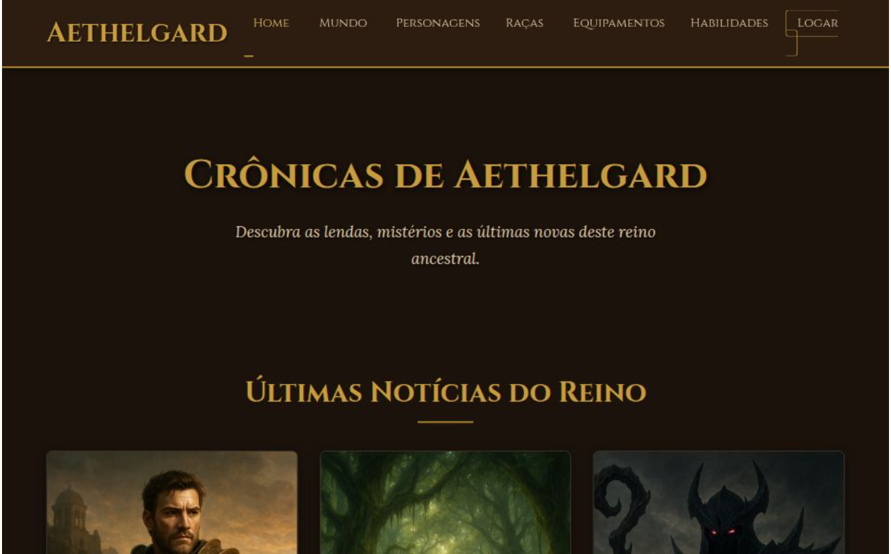

# Aethelgard Online

RPG de navegador (estilo menus/missões/PVP) feito com **Next.js 15 + Supabase**.



## Arquitetura

```
Navegador (React)  ──►  Next.js (rotas /api, server components)  ──►  Supabase Postgres
  só exibe estado          valida (Zod), rate limit, regras do jogo        RLS + funções atômicas
  e envia "intenções"      usa service_role para escrever                  ledger de moedas
```

**Regras de segurança (Fase 1):**

| Ameaça | Defesa |
|---|---|
| Editar ouro/XP pelo Console | O cliente **não tem permissão de escrita** em nenhuma tabela (RLS + `REVOKE`). Toda escrita é feita pelo backend via funções SQL (`wallet_apply`, `create_character`) executáveis só pela `service_role`. |
| Mandar campos extras (`"gold": 99999`) | Schemas Zod `.strict()` — o cliente envia só nome/raça/região/gênero; atributos e ouro são calculados no servidor. |
| Acelerar energia mudando o relógio | Energia é derivada de `energy_updated_at` usando o horário do **servidor** (`src/lib/game/rules.ts`). |
| Saldo negativo / gasto duplo | `CHECK (gold >= 0)`, lock de linha e `ledger.ref` único (idempotência para webhooks de pagamento). |
| Ver dados de outro jogador | Policies `user_id = auth.uid()`. |
| CSRF / clickjacking / XSS | Checagem de `Origin` nas rotas POST, cookies SameSite, CSP, `X-Frame-Options: DENY`. |
| Bots / spam | Rate limit por usuário (Upstash Redis em produção, memória em dev). |
| Vazar a chave secreta | `SUPABASE_SERVICE_ROLE_KEY` só é lida em módulos `server-only`. |

## Estrutura

```
src/app/            páginas (/, /login, /criar-personagem, /jogo) e rotas /api
src/lib/game/       dados do mundo e regras puras (XP, HP, energia)
src/lib/supabase/   clientes: browser (anon), server (sessão), admin (service_role)
src/lib/security/   rate limit, CSRF, redirect seguro
src/middleware.ts   renova sessão e protege rotas
supabase/migrations esquema SQL + RLS
public/assets/      imagens do jogo
legacy/             versão HTML original (referência; será removida ao fim da migração)
```

## Rodando localmente

1. **Crie um projeto** em <https://supabase.com> (plano grátis serve).
2. No painel: **SQL Editor → New query**, cole e rode **em ordem** cada arquivo de `supabase/migrations/` (`0001` a `0009`).
3. Copie as chaves: **Project Settings → API**.
   ```bash
   cp .env.example .env.local   # e preencha os valores
   ```
4. **Auth → URL Configuration**: Site URL `http://localhost:3000` e adicione `http://localhost:3000/auth/callback` em *Redirect URLs*.
5. **Auth → Providers**:
   - **Email**: já vem ativo (deixe "Confirm email" ligado).
   - **Google**: crie um OAuth Client em <https://console.cloud.google.com/apis/credentials> (tipo *Web*), com redirect URI `https://SEU-PROJETO.supabase.co/auth/v1/callback`. Cole Client ID/Secret no Supabase.
   - **Facebook**: crie um app em <https://developers.facebook.com> → *Facebook Login* → Valid OAuth Redirect URI `https://SEU-PROJETO.supabase.co/auth/v1/callback`. Cole App ID/Secret no Supabase.
6. Instale e rode:
   ```bash
   npm install
   npm run dev
   ```
   Abra <http://localhost:3000>.

## Core loop (Fase 2)

| Sistema | Onde a regra vive | Anti-cheat |
|---|---|---|
| Missões com timer | `src/lib/game/quests.ts` + `start_quest` / `claim_quest` (SQL) | Recompensa sorteada no servidor ao iniciar; resgate só se `now() >= ends_at` no relógio do banco; 1 missão ativa por vez. |
| Caçada PVE por turnos | `src/lib/game/combat.ts` + `/api/battle/*` | Estado da luta salvo no banco; cliente envia só a ação; RNG criptográfico; versão otimista impede clique duplo. |
| Arena PVP | `/api/pvp/fight` + `apply_pvp_result` | Luta simulada inteira no servidor; ±5 níveis; máx. 3 desafios/h ao mesmo alvo; Elo. |
| Níveis e atributos | `grant_rewards`, `spend_attribute_points` | Level up calculado no SQL; +3 pontos por nível. |
| Inventário | `give_item`, `toggle_equip`, `consume_item` | Unicidade de 1 item equipado por slot no banco. |

### Imagens dos inimigos (geradas no Canva)

Os arquivos em `public/assets/enemies/` (agora em `.webp`) são **prévias em baixa resolução**. Baixe as versões completas no Canva e substitua mantendo o mesmo nome:

| Arquivo | Canva |
|---|---|
| `sombra_fraca.webp` | https://www.canva.com/M/MAHaAP1GQXA |
| `lobo_corrompido.webp` | https://www.canva.com/M/MAHaAEHKcBs |
| `vulto_menor.webp` | https://www.canva.com/M/MAHaAATp6OQ |
| `culto_acolito.webp` | https://www.canva.com/M/MAHaANiI3iw |
| `javali_corrompido.webp` | https://www.canva.com/M/MAHaAKuC0Tc |
| `lider_cultista.webp` | https://www.canva.com/M/MAHaAFDagaA |
| `golem_gelo.webp` | https://www.canva.com/M/MAHaAttcoLM |
| `escorpiao_ambar.webp` | https://www.canva.com/M/MAHaAgixiYY |
| `serpente_abissal.webp` | https://www.canva.com/M/MAHaAvChFMk |

## Economia e pagamentos (Fase 3)

**Moedas:** 🪙 Ouro (grátis, ganho jogando) e 💎 Gemas (premium, compradas ou no login diário).

**Fluxo de compra (seguro):**
1. Jogador escolhe o pacote → `POST /api/shop/checkout` cria um pagamento **pendente** com o preço do catálogo do servidor.
2. É redirecionado ao checkout hospedado (Stripe ou Mercado Pago). Dados de cartão nunca passam pelo nosso servidor.
3. O gateway chama o **webhook** (`/api/webhooks/stripe` ou `/api/webhooks/mercadopago`). Validamos a **assinatura HMAC**, consultamos o valor/moeda e chamamos `fulfill_payment` (idempotente).
4. Estorno/chargeback → `refund_payment` remove as gemas; se já foram gastas, a conta é marcada para revisão.

| Gateway | Moedas | Métodos |
|---|---|---|
| Mercado Pago | BRL | Pix, cartão, boleto |
| Stripe | BRL e USD | Cartão (+ métodos ativados no painel) |

**Teste local sem gateway:** com `PAYMENTS_DEV=1` (e fora de produção), aparece o botão "Teste (dev)" que aprova o pagamento na hora.

**Monetização:** pacotes de gemas (âncora "Melhor valor"), **gemas em dobro na 1ª compra**, Pacote do Aventureiro (oferta única), recarga de energia com preço progressivo no dia, concluir missão com gemas, Elixir +50% XP, ofertas do dia com cronômetro (rotação automática), cosméticos de **estoque global limitado**, login diário de 7 dias. Sem loot boxes pagas.

Para criar novas ofertas limitadas, rode no SQL Editor:
```sql
insert into limited_offers (id, cosmetic_id, price_gems, stock_total, ends_at)
values ('natal_moldura', 'frame_arcano', 300, 1000, now() + interval '7 days');
```

### Artes da loja (Canva)

Em `public/assets/shop/` (200×200, suficiente para ícones). Originais: gemas [pequeno](https://www.canva.com/M/MAHaAXn073w) / [baú](https://www.canva.com/M/MAHaASvU90A), molduras [dragão](https://www.canva.com/M/MAHaAex5OCo) / [arcana](https://www.canva.com/M/MAHaAXWeEhc), poções [vida](https://www.canva.com/M/MAHaAR39AaE) / [energia](https://www.canva.com/M/MAHaAWGXAms).

## Roadmap

- [x] **Fase 1** — Next.js, Supabase, login (e-mail/Google/Facebook), RLS, criação de personagem no servidor
- [x] **Fase 2** — Missões com timer, combate PVE por turnos, PVP assíncrono com ranking Elo, níveis/atributos, inventário/equipamentos, UI animada
- [x] **Fase 3** — Gemas (premium), recarga de energia, loja de cosméticos, ofertas limitadas, login diário, Stripe + Mercado Pago
- [ ] **Fase 4** — `DEPLOY.md` (domínio, SSL, Cloudflare, banco em produção)
